 

  

<a href="#about"><b>ABOUT</b></a> &nbsp;&#124;&nbsp;
<a href="#focus"><b>FOCUS</b></a> &nbsp;&#124;&nbsp;
<a href="#stack"><b>STACK</b></a> &nbsp;&#124;&nbsp;
<a href="#projects"><b>PROJECTS</b></a> &nbsp;&#124;&nbsp;
<a href="#roadmap"><b>ROADMAP</b></a> &nbsp;&#124;&nbsp;
<a href="#stats"><b>STATS</b></a> &nbsp;&#124;&nbsp;
<a href="#collaborate"><b>COLLABORATE</b></a> &nbsp;&#124;&nbsp;
<a href="#contact"><b>CONTACT</b></a>

## About

 

I'm an AI enthusiast and aspiring Android developer who likes turning ideas into useful, well-designed apps. I'm still learning, and I document honestly what works and what is still planned.

## Focus

| | Area | What it means to me |
|:--:|:--|:--|
| 01 | **Artificial Intelligence** | Integrating AI models and APIs into real products |
| 02 | **Android** | Native apps with Kotlin and Jetpack Compose |
| 03 | **AI Agents** | Assistants that can take useful actions |
| 04 | **Automation** | Removing repetitive work |
| 05 | **UI/UX** | Clean, modern, responsive interfaces |

### Current learning goals

- Build solid Android apps with Kotlin and Jetpack Compose
- Integrate AI providers into mobile apps
- Design reliable, user-friendly interfaces
- Contribute to open-source projects

## Stack

<!-- Edit these so they match what you actually use. -->

<table>
<tr>
<td width="50%" valign="top">

**USING**

</td>
<td width="50%" valign="top">

**LEARNING**

Jetpack Compose &middot; AI provider APIs

</td>
</tr>
</table>

| Area | Technologies |
|:--|:--|
| Languages | Kotlin |
| Android | Android Studio, Jetpack Compose *(learning)* |
| AI / ML | AI provider APIs *(learning)* |
| Web | *add if applicable* |
| Tools | Android Studio |
| Version control | Git, GitHub |

## Projects

**Implemented:** *[fill in what actually works]* &nbsp;&#124;&nbsp; **Repository:** *[add link when available]*

 

**Implemented:** *[fill in what actually works]* &nbsp;&#124;&nbsp; **Repository:** *[add link when available]*

<b>Honest notes on both projects</b>

 

- Both are evolving projects, not finished products.
- Planned features are goals, not claims. Only the "Implemented" line reflects what works today.
- AI Place Finder is best-effort. Social platforms restrict access to media and metadata, so identification is never guaranteed and should be verified.

## Roadmap

| Milestone | Status |
|:--|:--|
| First working version of MAX AI Assistant |  |
| Prototype AI Place Finder share flow |  |
| Publish repositories with clear READMEs |  |
| Add screenshots and demos |  |
| First open-source contribution |  |

<!-- Update a badge as you progress:
IN PROGRESS: https://img.shields.io/badge/IN%20PROGRESS-FF7A00?style=flat-square&labelColor=1E1E1E
DONE:        https://img.shields.io/badge/DONE-2EA043?style=flat-square&labelColor=1E1E1E -->

## Stats

Stats come from third-party services and may be briefly unavailable. Private repository activity may not be counted.

<!-- Optional contribution snake. Enable only after adding .github/workflows/snake.yml,
running it once, and confirming the "output" branch exists. Then uncomment:

<picture>
  <source media="(prefers-color-scheme: dark)" srcset="https://raw.githubusercontent.com/tejas5-a/tejas5-a/output/github-contribution-grid-snake-dark.svg" />
  
</picture>

-->

## Principles

- **Honest docs:** say what works and what doesn't
- **Simple code:** readable beats clever
- **User first:** design for the person using it
- **Small steps:** iterate, test, repeat

## Open-source goals

- Learn from well-maintained Android and AI projects
- Make a first open-source contribution
- Share progress through documented projects

## Collaborate

Open to learning together and collaborating on Android, AI agent, and automation projects.

## Contact

<!-- Replace placeholders or delete lines you don't want. -->

<!--  -->
<!--  -->

